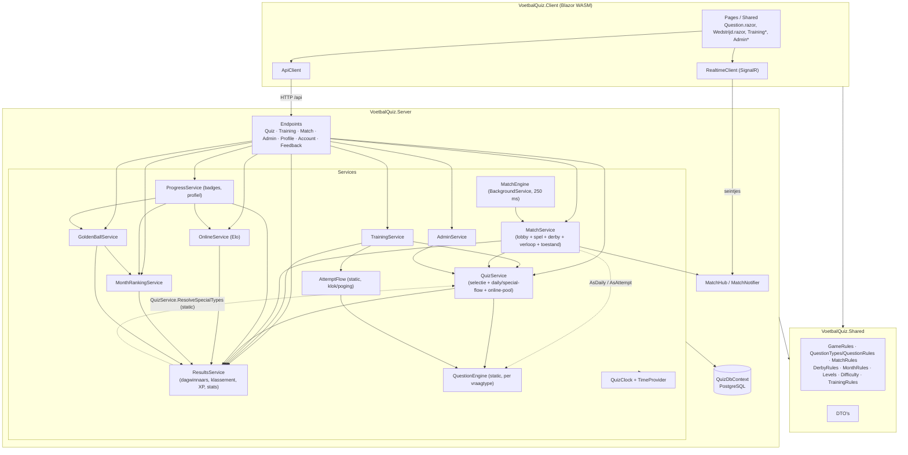

# Architectuuranalyse Truitje Trek – 20 oktober 2026

Eerste volledige architectuurcheck. Geanalyseerd: de werkboom van `main` (79828fa) **inclusief de niet-gecommitte wijzigingen**
(Academie/training: `TrainingService`, `AttemptFlow`, `TrainingEndpoints`, `Training*.razor`, migraties `TrainingRuns` en
`DataProtectionKeys`). Er is in deze analyse geen code gewijzigd.

> Let op: de werkboom veranderde tijdens de analyse. Rond 18:26 werden `TrainingService.cs`, `TrainingEndpoints.cs`,
> `ResultsService.cs` en `Shared/Training.cs` uitgebreid (afgelopen specials in de academie, "Opnieuw spelen").
> Regelnummers van die bestanden gelden voor de versie van 18:27.

## Uitgangssituatie

| Controle | Resultaat |
|---|---|
| `dotnet build --no-incremental` | geslaagd, 0 fouten, **5 warnings** (allemaal CS8602 in tests: `QuizServiceTests.cs:55,63`, `SpecialAndProgressTests.cs:65,80,144`) |
| `dotnet test` | **240 geslaagd**, 0 gefaald, 0 overgeslagen (bij de eerste run, vóór de wijziging van 18:26: 237) |
| `dotnet ef migrations has-pending-model-changes` | geen openstaande modelwijzigingen: snapshot en migraties kloppen |

Grootste bestanden (zonder migraties): `MatchService.cs` 873, `QuizService.cs` 624, `Wedstrijd.razor` 542,
`QuestionEngine.cs` 465, `ResultsService.cs` 426, `TrainingService.cs` 386, `Entities.cs` 383, `ProgressService.cs` 342.
Meest gewijzigd in de geschiedenis (buiten JSON-inhoud): `app.css`, `Entities.cs`, `QuizService.cs`, `CreateTableForm.razor`,
`Wedstrijd.razor`, `MatchService.cs`.

## Huidige architectuur

Drie projecten plus tests, met de afhankelijkheden in de goede richting:

- **Shared** hangt van niets af. Bevat DTO's en pure regels (`GameRules`, `QuestionRules`/`QuestionTypes`, `MatchRules`,
  `DerbyRules`, `MonthRules`, `Levels`, `Difficulty`, `TrainingRules`).
- **Client** (Blazor WASM) hangt enkel van Shared af. `ApiClient` per HTTP, `RealtimeClient` voor SignalR-seintjes;
  de klok op de client is enkel weergave en wordt bij elke toestand gelijkgezet met de server.
- **Server** host de client, en bevat dunne endpoints, services, EF Core (PostgreSQL) en SignalR (`MatchHub` + `MatchEngine`).
  Migraties en seeding lopen bij het opstarten (`Program.cs:55-61`).
- **Tests** (xUnit) testen regels en services tegen SQLite in-memory met `FakeTimeProvider`.

De drie speelflows en waar ze hun regels halen:

| Flow | Service | Poging bewaard in | Klok/poging-logica | Vraag-engine |
|---|---|---|---|---|
| Daily + specials | `QuizService` | `Attempts` | eigen kopie (`QuizService.cs:495-605`) | `QuestionEngine` |
| Academie (training) | `TrainingService` | `TrainingRuns` / `TrainingAttempts` | `AttemptFlow` | `QuestionEngine` |
| Online (+ derby) | `MatchService` | `MatchAnswers` | eigen variant (`MatchService.cs:214-275`), gedeelde klok per vraag | `QuestionEngine` via adapter `AsDaily`/`AsAttempt` |

## Wat goed zit (niet wegrefactoren)

- **Server-autoriteit is consequent.** `QuestionEngine.Visible` geeft nooit het antwoord; `Result` komt pas als de poging
  afgelopen is (`AttemptFlow.State`, `QuizService.StateAsync`). Tijd komt uit `StartedAt` op de server, met een vaste
  `LatencyGraceSeconds`. `Attempt.Guesses` is een concurrency token tegen gelijktijdige gokken. Derby-wapens worden atomair
  geclaimd met `ExecuteUpdateAsync` (`MatchService.cs:349-383`). De daily van vandaag lekt niet naar online en training.
- **Eén plek per vraagtype.** `QuestionEngine` bundelt tijdslimiet, zichtbaarheid, beoordeling, deelpunten en eindweergave
  per type; de getallen staan in Shared (`QuestionRules`, `GameRules`). Een nieuw type toevoegen is goed afgebakend (skill
  `nieuw-vraagtype`).
- **Shared is puur en wordt door de client enkel voor weergave gebruikt** (`QuestionDisplay.cs`, `QuestionTypes.Mix` in
  `AdminSpecial.razor`/`AdminPlanning.razor`): de verdeling die de admin ziet is dezelfde code als op de server.
- **Training in eigen tabellen** (`TrainingRun`/`TrainingAttempt`) met een gedeelde basisklasse `AttemptState`: alles wat
  `Attempts` leest (klassementen, XP, badges) blijft vanzelf competitie. Dat is een goede, eenvoudige keuze.
- **Injecteerbare tijd.** `TimeProvider` + `QuizClock` (Belgische dag) op de server, `FakeTimeProvider` in de tests.
- **Dunne endpoints** (op Feedback na) met één foutfilter (`QuizException` -> 400).
- **Geen overbodige lagen**: geen repositories, mediator of extra projecten. De `IMatchNotifier`-interface is de enige
  abstractie en heeft een echte reden (testen zonder SignalR).
- **Migraties zijn op orde** en de testsuite is ruim (240 tests, ook derby, specials, training en Gouden Bal).
- Client hergebruikt `Question.razor` voor daily, special en training; `ApiClient` kiest enkel het adres.

## Bevindingen

Ernstigste eerst.

### B1 – De poging-logica bestaat drie keer, en online wijkt al af (hoog)

- `QuizService.cs:495-605` (`GuessAsync`, `GiveUpAsync`, `StateAsync`, `CloseIfExpired`, `StatusOf`, `Seconds`) is vrijwel
  regel voor regel gelijk aan `AttemptFlow.cs:12-93`. De doc van `AttemptFlow` zegt zelf "zelfde regels als de daily in
  QuizService": twee kopieën die met de hand gelijk gehouden moeten worden.
- `MatchService.cs:214-255` is een derde variant. Ze werkt via adapters `AsDaily` en `AsAttempt` (`MatchService.cs:172-196`)
  en kopieert na `QuestionEngine.Guess` de gemuteerde velden met de hand terug (`MatchService.cs:226`).
- **De afwijking is er al:** online telt geen pogingen en past `GameRules.MaxGuessesPerQuestion` (40) niet toe. Bij een
  opstelling en een counter kost fout gokken niets, dus een script dat namen afvuurt is online onbegrensd. In de daily is
  dat net de reden van de limiet (`GameRules.cs:25-29`). `MatchAnswer` heeft ook geen `Guesses`-kolom en geen concurrency
  token.
- **Waarom het pijn doet:** elke wijziging aan de spelregels van een poging (grace, maximum, deelpunten bij stoppen, wat
  "klaar" is) moet op drie plaatsen, en als `QuestionEngine.Guess` ooit een nieuw veld van de poging muteert, verliest online
  dat stil (de terugkopie in regel 226 kent het niet).

### B2 – `QuizService` is de spil van alles en heeft vier redenen om te wijzigen (hoog)

`QuizService.cs` (624 regels) doet:

1. vragen **selecteren** (`BuildAsync`, `BuildMixAsync`, `PickPlayersAsync`, `PickItemsAsync`, `PickByPlan`; regels 96-300),
2. de **daily- en special-reeks** aanmaken en laden (37-89, 250-377),
3. de **online-pool** en derby-wissel (302-345),
4. **spelen** (overzicht, start, gokken, afsluiten; 379-623) en de Home-rangpositie (428-457).

`MatchService`, `TrainingService` en `AdminService` hangen van de hele klasse af terwijl ze enkel selectie
(`BuildOnlineAsync`, `BuildReplacementAsync`, `SpecialShortagesAsync`) of laden (`LoadChallengeAsync`) nodig hebben.
Daarnaast worden statics als `QuizService.DifficultyOf` (407) en `QuizService.ResolveSpecialTypes` (272) vanuit
`TrainingService` en `ResultsService` (`ResultsService.cs:196`) aangeroepen, terwijl `QuizService` zelf van
`ResultsService` afhangt.

**Waarom het pijn doet:** een wijziging aan de selectie (moeilijkheidsplan, rotatie, thema's) raakt hetzelfde bestand als
een wijziging aan de puntentelling, en elke nieuwe modus (training, online) moet `QuizService` erbij nemen. Het is het
op twee na meest gewijzigde bestand.

### B3 – `MatchService` bundelt lobby, spel, derby, verloop en toestand (middel)

`MatchService.cs` (873 regels): lobby (19-167), spelen (212-275), **derby** (277-622, bijna 350 regels: wapens claimen,
`WhyNot`, wissel, Trump, rode kaart, gok, stelen, derby-toestand), **verloop in de tijd** (624-743, aangeroepen door
`MatchEngine`) en de **toestand voor de client** (745-843). De afrekening van een vraag (`EndQuestion` + `Apply*`) is pure
logica op het aggregaat `Match`, maar zit in een service met `DbContext` en notifier, en is daardoor enkel via de database
te testen (`DerbyTests.cs` is 515 regels).

**Waarom het pijn doet:** een nieuw wapen of een wijziging aan de puntentelling online raakt een bestand van bijna 900
regels waarin ook de lobby en de toestand staan; de volgorde van `ApplyTrump -> posities -> ApplyRedCards -> ApplyGambles ->
ApplySteals` (688-724) is een spelregel die nergens apart getest kan worden.

### B4 – Online en training kunnen vragen van een lopende special verklappen (middel)

- `QuizService.cs:337-345` (`OnlinePoolAsync`) sluit enkel uit wat in een reeks zit met `Date == Today`. Een special-reeks
  heeft `Date = special.StartDate` (`QuizService.cs:264`), dus de vragen van een special die meerdere dagen loopt zijn enkel
  op haar startdag beschermd.
- `TrainingService.cs:125-137` (`OpenTodayAsync`) kijkt enkel naar de daily van vandaag, niet naar lopende specials.
- Specials tellen mee voor het maandklassement (`ResultsService.PodiumsAsync`, inclusief specials) en voor badges.

**Waarom het pijn doet:** het principe "de server verklapt niets" geldt nu voor de daily maar niet voor specials; wie
online speelt of traint kan het antwoord van een lopende special leren. De regel "wat is nog competitief open?" staat ook op
twee plaatsen, telkens anders uitgewerkt (`OnlinePoolAsync` per dag, `OpenTodayAsync` per speler en per vraag).

### B5 – Gelijktijdige schrijvers op een wedstrijd zonder concurrency-bescherming (middel)

`MatchEngine` (`MatchRealtime.cs:32-49`) zet elke 250 ms in een eigen scope wedstrijden verder, terwijl requests in hun eigen
scope dezelfde rijen wijzigen. `MatchAnswer` en `MatchPlayer` hebben geen concurrency token. Voorbeelden van mogelijke
verloren of inconsistente updates:

- een gok die geladen werd vóór `EndQuestion` (`MatchService.cs:688-724`) en erna bewaard wordt, zet `Correct`/`SpeedPoints`
  op een antwoord waarvan de score en positie al afgerekend zijn;
- `LeaveAsync` (`MatchService.cs:92-120`) zet `Score = 0` terwijl de engine tegelijk punten bijtelt.

Daarnaast werkt het geheel enkel met **één serverinstantie**: `MatchEngine` als `BackgroundService`, SignalR-groepen zonder
backplane en `IMemoryCache` voor `UserCardsAsync`. Bij twee instanties zou een vraag twee keer afgerekend kunnen worden.

**Waarom het pijn doet:** de fouten zijn zeldzaam en moeilijk te reproduceren, dus ze worden pas gevonden als iemand klaagt
over een score. Elke uitbreiding van derby (meer schrijfacties) vergroot de kans.

### B6 – De inhoud van een vraag staat twee keer in het datamodel; counter-spelers worden drie keer met de hand geladen (middel)

- `DailyQuestion` (`Entities.cs:65-90`) en `MatchQuestion` (`Entities.cs:224-263`) hebben dezelfde inhoudsvelden (`Type`,
  `PlayerId/Player`, `QuizItemId/QuizItem`, `Blanks`, `CounterPlayerIds`, `CounterPlayers`).
- `QuestionEngine` werkt op de entiteit `DailyQuestion` (`QuestionEngine.cs:15` e.v.), daarom de adapter `AsDaily` in
  `MatchService` en de kopie in `QuestionEngine.WithAnswer` (301-319).
- `CounterPlayerIds` is een int-array zonder foreign key; `CounterPlayers` is `[NotMapped]` en wordt met de hand ingeladen
  in `QuizService.cs:80-87`, `TrainingService.cs:378-385` en `MatchService.cs:856-863`. Ook "welke spelers zitten in deze
  vraag" staat drie keer: `QuizService.cs:340-341`, `TrainingService.cs:139`, `MatchService.cs:445-446`.

**Waarom het pijn doet:** een nieuw inhoudsveld voor een vraagtype (zoals `Blanks` destijds) moet in twee entiteiten, twee
mappings, de adapter en de kopie; vergeet je het laden van counter-spelers op een nieuwe plaats, dan toont een counter
"0 spelers" zonder foutmelding.

### B7 – Regels en getallen buiten Shared of dubbel (laag tot middel)

- `QuizService.cs:16` `MaxClassicPerDay = 2` en de magische string `"classic"` (169, 174): selectieregel buiten Shared.
- `QuizService.cs:206`: de lijst types "waar het antwoord het onderwerp is" staat inline in de selectie.
- Opstelling 200 punten hardcoded in `QuestionEngine.cs:88` en `QuestionTypes.cs:199`, terwijl `QuestionTypes.Get(...).MaxPoints`
  het al weet.
- De volgorde van het dagklassement staat in `ResultsService.cs:44-49` (`RankDay`) en nog eens, met de hand uitgeschreven,
  in `TrainingService.WouldBeRank` (`TrainingService.cs:251-254`).
- De regel "speel de vragen in volgorde" staat twee keer (`QuizService.cs:471-475`, `TrainingService.cs:192-197`).
- `QuizService.ResolveTypes`/`ResolveSpecialTypes` (31-32, 272-277) zijn pure regels die in `QuestionTypes` horen (naast
  `ResolveDay`).
- Badge-drempels staan in `ProgressService.cs:23-96`. Dat is aanvaardbaar zolang de client ze niet zelf nodig heeft; noteer
  het als bewuste keuze.

**Waarom het pijn doet:** wie de puntentelling of de klassementsvolgorde wijzigt, vindt niet alle plaatsen via Shared, en
de training-score "je plaats als je toen zo gespeeld had" kan stil gaan afwijken van het echte klassement.

### B8 – Tijd en tijdzone niet overal via de klok (laag)

- `ProgressService.cs:10,188` heeft een eigen `Europe/Brussels`-tijdzone naast `QuizClock`.
- `DateTime.UtcNow` rechtstreeks in `AdminService.cs:71,244,288`, `FeedbackEndpoints.cs:43` en als standaardwaarde in
  `Entities.cs:8` (`AppUser.CreatedAt`).
- De client bepaalt "vandaag" en "deze maand" met `DateTime.Today` in de **lokale tijd van de browser**:
  `Klassement.razor:57,62`, `SpecialStatus.razor:3`, `AdminSpecial.razor:192`, `AdminSpecials.razor:31`,
  `AdminPlanning.razor:28-29`. Rond middernacht, of voor wie niet in de Belgische tijdzone zit, tonen die schermen een andere
  dag dan de server hanteert.

**Waarom het pijn doet:** tests met `FakeTimeProvider` dekken deze paden niet, en fouten rond middernacht zijn precies het
soort bug dat je pas in productie ziet.

### B9 – Lezen met neveneffecten en volledige tabelscans (laag tot middel)

- `GET /api/daily` maakt de reeks aan en bewaart (`QuizService.GetOverviewAsync`, 381-404); `TrainingService.OpenTodayAsync`
  maakt zo nodig de daily van vandaag aan; `ResultsService.SettleFinishedDaysAsync` wordt vanuit minstens zes leespaden
  aangeroepen (o.a. `XpInputsAsync`, `PodiumsAsync`, `GetSpecialsAsync`, `GetStatsAsync`, `ProgressService.FactsAsync`).
- `ResultsService.XpInputsAsync` (67-98) laadt **alle** beantwoorde pogingen van iedereen in het geheugen; dat gebeurt bij
  `LevelOfAsync` (ongecachet, o.a. per profiel), `ProgressService.ClaimRewardAsync` en elke 10 s via `UserCardsAsync`
  (ook tijdens elke poll van een wedstrijd). `GetStatsAsync` (291-383) laadt eveneens alle rijen.

**Waarom het pijn doet:** voor een vriendengroep is dit vandaag geen probleem, maar de kost groeit lineair met elke
gespeelde dag. En omdat afsluiten "lui" gebeurt bij het lezen, is het moeilijk te zeggen welk endpoint wat schrijft.

### B10 – Kleine slordigheden in de HTTP-laag (laag)

- De admin-controle staat in `FeedbackEndpoints.IsAdmin` (`FeedbackEndpoints.cs:64-68`) en wordt vanuit
  `AdminEndpoints.cs:13-16` en `AccountEndpoints.cs:107` aangeroepen; dat hoort als autorisatiepolicy in `Program.cs`.
- `FeedbackEndpoints.cs:15-57` werkt rechtstreeks op `QuizDbContext` (de enige endpoints zonder service).
- De helper `UserId(ClaimsPrincipal)` staat vier keer gekopieerd; `HandleQuizErrors` woont in `QuizEndpoints` maar wordt
  door alle groepen gebruikt.

### B11 – Tests: veel gekopieerde opzet en geen dekking van PostgreSQL-specifieke zaken (laag)

- Twaalf testklassen bouwen elk hun eigen SQLite-in-memory-database met `EnsureCreated` en hun eigen services op.
- Daardoor worden de **migraties** en PostgreSQL-specifiek gedrag (gefilterde unieke indexen, int-arrays, `ExecuteUpdate`
  voor de derby-claims) nooit getest.
- `ProgressService` wordt enkel onrechtstreeks getest. Vijf nullable-warnings in de tests.

### B12 – Naamgeving en verankering van specials in het datamodel (laag)

- `DailyChallenge`/`DailyQuestion` bevatten ook specials en worden door training gebruikt; `PlayerStatus` wordt ook
  voor `QuizItem` gebruikt.
- Een special hangt aan **verschillende datums** afhankelijk van wie kijkt: de reeks krijgt `Date = StartDate`
  (`QuizService.cs:264`), het maandklassement telt hem in de maand van `c.Date` (`ResultsService.cs:143`), de academie zet
  hem op zijn **einddatum** (`TrainingService.cs:32-34,50`).
- Een dagvraag verwijst naar de veranderlijke `Player`/`QuizItem`: past een admin overdag een speler aan, dan verandert de
  lopende vraag (tips, aanvaarde antwoorden) en ook de geschiedenis. Dat kan een bewuste keuze zijn (zie Open vragen).

## Refactorplan

Elke stap is los te mergen, laat `dotnet build` en `dotnet test` groen en behoudt de publieke contracten (DTO's in Shared,
API-routes, SignalR-berichten `LobbyChanged`/`MatchChanged`). Omvang: S = minder dan een halve dag, M = ongeveer een dag,
L = meerdere dagen.

**Vooraf:** commit eerst de lopende Academie-feature. Refactoren op een werkboom die nog verandert, geeft conflicten.

### Fase 0 – Vangnet

| Stap | Wat | Bestanden | Risico | Verificatie | Omvang |
|---|---|---|---|---|---|
| 0.1 | Karakteriseringstests voor de online pogingflow: gokken en passen per type (vooral opstelling, counter, jaar), tijd om, verlenging. Plus de daily-flow waar `QuizServiceTests` die nog niet afdekt (maximaal aantal pogingen, gelijktijdige gok). | `tests/…/MatchServiceTests.cs`, `QuizServiceTests.cs` | geen | nieuwe tests groen op de huidige code | S |
| 0.2 | Eén gedeelde testopzet (`TestDb`: SQLite-connectie, context, klok, services) en de 5 nullable-warnings oplossen. | `tests/…` | laag | zelfde aantal tests groen, 0 warnings | S |

### Fase 1 – Veel winst, weinig risico (geen gedragswijziging)

| Stap | Wat | Bestanden | Risico | Verificatie | Omvang |
|---|---|---|---|---|---|
| 1.1 | `QuizService` gebruikt `AttemptFlow` voor gokken, passen, afsluiten en toestand; de kopie in `QuizService.cs:495-605` verdwijnt. (B1) | `QuizService.cs`, `AttemptFlow.cs` (doc) | laag | `QuizServiceTests`, `QuestionTypeTests`, `NewRoundTests`, `HomeTests` | S |
| 1.2 | Gedeelde helpers voor wat in meerdere services gekopieerd staat: concurrency-veilig bewaren van een poging (`SaveAsync`), counter-spelers laden, "spelers van een vraag", "speel in volgorde". Eén statische helper per onderwerp, geen nieuwe laag. (B6, B7) | `QuizService.cs`, `TrainingService.cs`, `MatchService.cs`, nieuw bv. `Services/ChallengeLoading.cs` | laag | volledige testsuite | S |
| 1.3 | Regels naar Shared: `ResolveTypes`/`ResolveSpecialTypes` naar `QuestionTypes`; `MaxClassicPerDay` en de "onderwerp"-types naar `QuestionRules`; 200 punten via `QuestionTypes.Get(...).MaxPoints`; de volgorde van het dagklassement als één vergelijker in Shared, gebruikt door `ResultsService.RankDay` en `TrainingService.WouldBeRank`. (B7) | `QuizService.cs`, `ResultsService.cs`, `TrainingService.cs`, `QuestionEngine.cs`, `Shared/QuestionTypes.cs`, `Shared/GameRules.cs` | laag | bestaande tests + een test die `WouldBeRank` tegen `RankDay` legt | S |
| 1.4 | Tijd: `QuizClock` krijgt `ToBrussels(DateTime)` (uur), `ProgressService` gebruikt die; `DateTime.UtcNow` in `AdminService` en `FeedbackEndpoints` vervangen door `TimeProvider`; `AppUser.CreatedAt` zetten bij registratie. Voor de client: "vandaag" uit de server halen (de DTO's dragen al een datum) of de pure Belgische-datumberekening naar Shared verhuizen. (B8) | `QuizClock.cs`, `ProgressService.cs`, `AdminService.cs`, `FeedbackEndpoints.cs`, `Entities.cs`, enkele Razor-pagina's | laag | tests met `FakeTimeProvider` rond middernacht | S |
| 1.5 | HTTP-laag: admin als autorisatiepolicy in `Program.cs`, `UserId()`-extensie, `HandleQuizErrors` naar een eigen `EndpointFilters`-klasse, Feedback via een kleine `FeedbackService`. (B10) | `Endpoints/*.cs`, `Program.cs` | laag (routes blijven gelijk) | handmatig: admin-pagina's, feedback; tests | S |

### Fase 2 – Gerichte splitsingen

| Stap | Wat | Bestanden | Risico | Verificatie | Omvang |
|---|---|---|---|---|---|
| 2.1 | **`QuestionPicker`** afsplitsen uit `QuizService`: alle selectie (`BuildAsync`, `BuildMixAsync`, `Pick*`, `PickByPlan`, online-pool, derby-wissel, special-pool en tekorten). `QuizService` houdt de daily/special-flow. `MatchService`, `TrainingService` en `AdminService` hangen dan af van wat ze echt gebruiken. Puur verplaatsen. (B2) | `QuizService.cs`, nieuw `QuestionPicker.cs`, `MatchService.cs`, `AdminService.cs`, `Program.cs`, tests | laag | volledige suite; `PickByPlan`-tests ongewijzigd | M |
| 2.2 | **Vraag-interface voor de engine**: `DailyQuestion` en `MatchQuestion` implementeren een kleine interface (Id, Number, Type, Player, QuizItem, Blanks, CounterPlayers); `QuestionEngine` werkt daarop. `AsDaily` verdwijnt; `WithAnswer` geeft een lichte kopie terug. Geen migratie. (B6) | `Entities.cs`, `QuestionEngine.cs`, `MatchService.cs`, `AttemptFlow.cs` | laag tot middel (veel signaturen) | volledige suite, vooral `DerbyTests` (Trump) | M |
| 2.3 | **Afrekening online als pure logica**: `EndQuestion`, `Apply*` en `Finish` naar een statische `MatchScoring` (zoals `QuestionEngine`) die enkel op het `Match`-aggregaat werkt; derby-acties (`UseWeaponAsync`, `ClaimAsync`, `WhyNot`, `SwapAsync`) naar een `DerbyService`. `MatchService` houdt lobby, spelen en toestand. (B3) | `MatchService.cs`, nieuw `MatchScoring.cs`, `DerbyService.cs`, `MatchEndpoints.cs`, `Program.cs`, tests | middel | `DerbyTests` + `MatchServiceTests` ongewijzigd groen; nieuwe tests op `MatchScoring` zonder database | M-L |

### Fase 3 – Gedrag en datamodel (pas na beslissing van de eigenaar)

| Stap | Wat | Bestanden | Risico | Verificatie | Omvang |
|---|---|---|---|---|---|
| 3.1 | **`MatchAnswer` erft van `AttemptState`** (kolom `SpeedPoints` blijft via `HasColumnName`, nieuw: `Guesses` als concurrency token en `StartedAt`) en online gebruikt `AttemptFlow.Guess`. Daarmee geldt `MaxGuessesPerQuestion` ook online en verdwijnen `AsAttempt` en de terugkopie. **Gedragswijziging + migratie** (skill `ef-migratie`). (B1, B5) | `Entities.cs`, `QuizDbContext.cs`, migratie, `MatchService.cs`, `AttemptFlow.cs` | middel | migratie nakijken; karakteriseringstests uit 0.1; `spelregel-reviewer` | M |
| 3.2 | **Lopende specials beschermen**: één regel "wat is voor deze speler nog competitief open" (daily van vandaag + lopende specials), gebruikt door de online-pool en door de academie. **Gedragswijziging.** (B4) | `QuestionPicker.cs` (of `QuizService.cs`), `TrainingService.cs`, tests | laag | nieuwe tests: special loopt, online/training vermijdt haar vragen; `spelregel-reviewer` | S-M |
| 3.3 | **Concurrency online**: een rowversion (`xmin` in PostgreSQL) op `Match` of op `MatchPlayer`/`MatchAnswer`; de engine en de requests vangen `DbUpdateConcurrencyException` op met herladen en opnieuw proberen. Expliciet documenteren dat de app één instantie verwacht. (B5) | `QuizDbContext.cs`, migratie, `MatchService.cs`, `MatchRealtime.cs` | middel | gerichte test met twee contexts; handmatig een partijtje met twee toestellen | M |
| 3.4 | Afsluiten van dagen en XP-berekening uit de leespaden halen: één plek die afsluit (bv. de bestaande `MatchEngine`-lus of een kleine dagelijkse `BackgroundService`), XP per gebruiker gericht opvragen in plaats van alle pogingen. Enkel doen als de snelheid een probleem wordt. (B9) | `ResultsService.cs`, `ProgressService.cs`, `Program.cs` | middel | tests op klassementen en badges; meten vóór en na | M |
| 3.5 | Optioneel: hernoemen `DailyChallenge` -> `Challenge`, `DailyQuestion` -> `ChallengeQuestion`, `PlayerStatus` -> `ContentStatus`. Raakt migraties, alle services en tests; weinig functionele winst. (B12) | breed | middel | volledige suite + migratie | L |

**Advies over "online en training één engine?":** nee voor de services, ja voor de bouwstenen. Daily, specials en de
academie delen nu al de reeks en `AttemptFlow`; online heeft een gedeelde klok per vraag, posities, bonussen en derby, en
hoort een eigen flow te houden. Wat ze moeten delen is `QuestionEngine` (stap 2.2) en de poginglogica (stap 3.1), niet één
grote service.

## Beslissingen van de eigenaar (20 oktober 2026)

| # | Vraag | Beslissing | Gevolg voor het plan |
|---|---|---|---|
| 1 | Mag het datamodel wijzigen? | **Ja, met migraties.** | Stap 3.1 en 3.3 gaan door. |
| 2 | Online maximaal 40 pogingen? | **Ja, dezelfde limiet als de daily** (`GameRules.MaxGuessesPerQuestion`). | Onderdeel van stap 3.1. |
| 3a | Lopende specials beschermen tegen online en academie? | **Nee.** Enkel de daily van vandaag blijft beschermd. | Stap 3.2 vervalt; B4 is aanvaard gedrag. |
| 3b | Online gespeelde vragen meetellen voor de daily-rotatie? | **Nee, zo laten.** | Geen wijziging. |
| 4 | Eén instantie in productie? | **Ja, gegarandeerd één instantie.** | In stap 3.3 enkel documenteren (README); geen backplane of gedeelde cache. |
| 5 | Admin past item aan dat in de daily van vandaag zit? | **Toegelaten, met waarschuwing** in het admin-paneel. | Nieuwe stap 3.6. |
| 6 | Bij welke maand hoort een special? | **De startdatum.** | Nieuwe stap 3.7: de academie gelijktrekken met het maandklassement. |
| 7 | `DailyChallenge` hernoemen? | **Nee.** | Stap 3.5 vervalt. |
| 8 | PostgreSQL in de tests? | **Ja, een migratie-rooktest** tegen een echte PostgreSQL. | Nieuwe stap 0.3. |

Bijkomende stappen:

| Stap | Wat | Bestanden | Risico | Verificatie | Omvang |
|---|---|---|---|---|---|
| 0.3 | **PostgreSQL-rooktest**: één test (bv. met Testcontainers) die alle migraties op een lege PostgreSQL toepast en een daily aanmaakt; overgeslagen als Docker ontbreekt. | `tests/VoetbalQuiz.Tests`, testproject-csproj | laag | test draait lokaal met Docker | S |
| 3.6 | **Waarschuwing bij aanpassen**: het admin-paneel toont bij een speler of vraag dat die vandaag in de daily (of een lopende special) zit, en vraagt bevestiging bij opslaan. | `AdminService.cs`, `AdminDtos.cs`, `AdminSpeler.razor`, `AdminVraag.razor` | laag | test op de vlag in de DTO; handmatig in het admin-paneel | S |
| 3.7 | **Special hoort bij de maand van haar startdatum**, ook in de academie; één helper in Shared die beide gebruiken. **Gedragswijziging** voor de academie. (B12) | `TrainingService.cs`, `MonthRules.cs`, tests | laag | test met een special die over twee maanden loopt | S |

## Open vragen voor de eigenaar (oorspronkelijk)

1. **Mag het datamodel wijzigen?** Stap 3.1 (`MatchAnswer` met `Guesses`/`StartedAt`) en 3.3 (rowversion) vragen een migratie.
2. **Moet online ook maximaal 40 pogingen per vraag toelaten?** Nu is dat onbeperkt; bij opstelling en counter is dat
   uit te buiten met een script.
3. **Moeten lopende specials beschermd worden tegen online en de academie** zoals de daily? En moeten vragen die online
   gespeeld zijn meetellen voor de rotatie van de daily (nu niet: wie online speelt, kan later een daily-vraag al kennen)?
4. **Draait productie gegarandeerd op één instantie?** Zo niet, dan zijn `MatchEngine`, SignalR zonder backplane en de
   geheugencache een probleem.
5. **Mag een admin een speler of vraag aanpassen terwijl ze in de daily van vandaag zit?** Zo niet: blokkeren of de inhoud
   vastleggen bij het aanmaken van de reeks.
6. **Bij welke maand hoort een special:** die van de startdatum (maandklassement nu) of de einddatum (academie nu)?
7. **Hernoemen `DailyChallenge` -> `Challenge`** (stap 3.5): de moeite waard, of laten zoals het is?
8. **PostgreSQL in de tests**: een migratie-rooktest tegen een echte PostgreSQL (bv. in CI) toevoegen, of bewust bij SQLite
   blijven?

## Niet gecontroleerd

- De app is niet gestart of doorgespeeld; geen PostgreSQL-database gebruikt.
- De races in B5 zijn afgeleid uit de code, niet gereproduceerd.
- Niet in detail gelezen: de meeste Razor-pagina's (behalve `Wedstrijd.razor` en de admin-specialpagina's gedeeltelijk),
  `AccountEndpoints`/`PasswordResetService`, de seeders, `GoldenBallService`, `MonthRankingService`, de inhoud van de
  migraties, `scripts/` en `tools/`.
- Geen prestatiemetingen; B9 is een inschatting op basis van de queries.
- De werkboom veranderde tijdens de analyse (Academie-uitbreiding rond 18:26); build en tests zijn daarna opnieuw
  gedraaid (240 groen).
